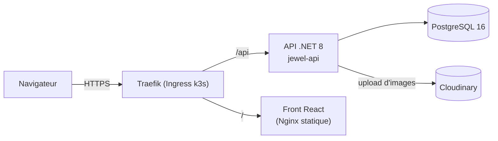
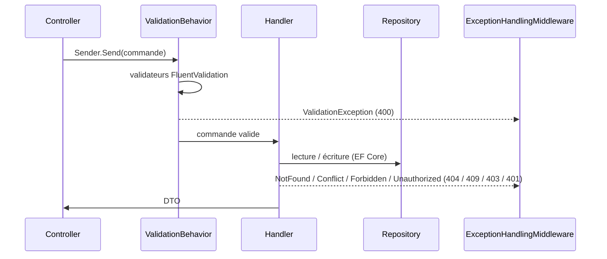
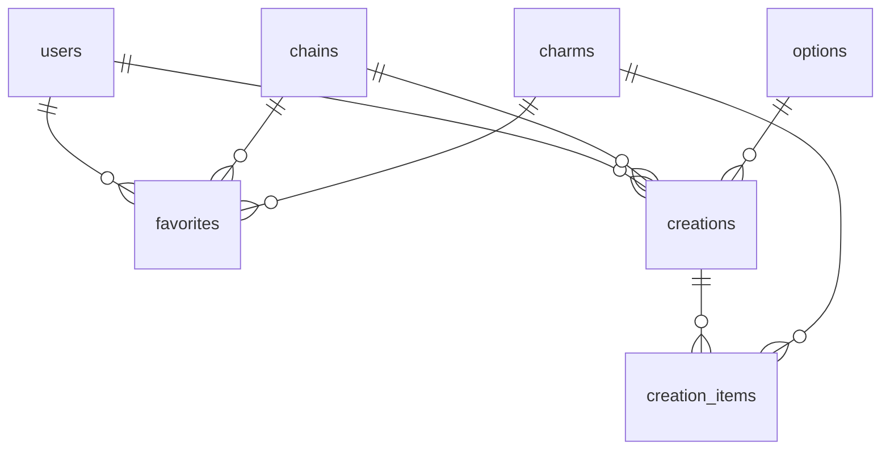
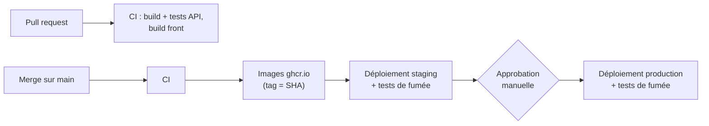
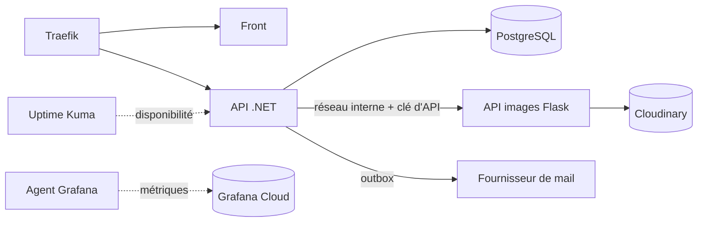

# Architecture de mycharmly

Ce document décrit l'architecture **actuelle** de l'application, puis les **évolutions prévues** par la [roadmap](ROADMAP.md).
Les conventions de code sont dans [`CONTRIBUTING.md`](../CONTRIBUTING.md).

---

## 1. Vue d'ensemble

mycharmly est une application web de création de colliers à breloques. Elle comprend un espace client (catalogue, favoris) et un espace admin (gestion du catalogue, utilisateurs).



| Composant | Rôle | Technologies |
|---|---|---|
| `jewel-front` | Interface client et admin, fichiers statiques servis par Nginx | React 18, TypeScript, Vite, MobX, Tailwind, axios, react-router 6 |
| `jewel-api` | API REST, logique métier, authentification | .NET 8, ASP.NET Core, MediatR, FluentValidation, EF Core (Npgsql), Evolve, BCrypt, JWT |
| PostgreSQL | Données de l'application | PostgreSQL 16 |
| Cloudinary | Stockage et diffusion des images produit | service externe |

Le front et l'API partagent le même domaine : le front appelle des URL relatives (`/api/...`) et la passerelle route `/api/` vers l'API et le reste vers le front.

---

## 2. API (`jewel-api`)

### Organisation en tranches verticales

Un seul projet, `JewelryShop.API`, organisé **par fonctionnalité** :

```
src/JewelryShop.API/
├── Program.cs                     # chargement du .env, migrations, démarrage
├── Startup.cs                     # injection de dépendances et pipeline HTTP
├── Application/
│   ├── Common/                    # ApiControllerBase, BaseEntity, PagedResult, exceptions,
│   │                              # ValidationBehavior, Repository<T>, interfaces de services
│   └── Features/<Fonctionnalité>/ # entité, repository, controller, Commands/, Queries/, DTOs/
└── Infrastructure/
    ├── Middlewares/               # ExceptionHandlingMiddleware
    ├── Persistence/               # AppDbContext, Configurations/ (mapping EF)
    └── Services/                  # JwtService, BcryptPasswordHasher, CloudinaryFileStorageService
```

Fonctionnalités existantes : `Auth`, `Admin`, `Users`, `Chains`, `Charms`, `Favorites`, `Creations`, `Options`.

### Traitement d'une requête



- Le controller ne fait que traduire la requête HTTP en commande MediatR.
- Le `ValidationBehavior` exécute tous les validateurs avant le handler.
- Les erreurs métier sont des exceptions typées, converties par le middleware en JSON `{ status, title, errors }`. Les 4xx sont journalisées en `Information`, les 5xx en `Error`.

### Authentification et autorisation

- `POST /api/auth/register` et `POST /api/auth/login` renvoient un **JWT** (HS256, valable `Jwt__ExpiresInDays` jours, 7 aujourd'hui) avec l'identifiant (`sub`) et le rôle.
- Mots de passe hachés avec BCrypt. Rôles : `User` et `Admin` (`UserRole`).
- Les endpoints admin portent `[Authorize(Roles = "Admin")]`. `AdminController` regroupe les routes `api/admin/...`.
- L'inscription est **publique** aujourd'hui.

### Données



| Table | Contenu |
|---|---|
| `users` | nom, prénom, email (unique), hash du mot de passe, date de naissance, rôle |
| `chains` | chaîne : nom, description, couleur, image, lien, coût, prix, longueur (`numeric(6,2)`) |
| `charms` | breloque : mêmes champs, avec un stock en unités au lieu de la longueur |
| `options` | longueurs proposées (nom, longueur `numeric(6,2)`) |
| `favorites` | favori d'un utilisateur : exactement une chaîne **ou** une breloque (contrainte `CHECK`) |
| `creations`, `creation_items` | création d'un utilisateur : une chaîne, une option, des breloques positionnées |

- Le schéma est créé par des **migrations SQL Evolve** (`jewel-api/db/migrations/V<n>__*.sql`). EF Core ne sert que d'ORM. Son mapping (`Infrastructure/Persistence/Configurations/`) reprend le schéma en snake_case.
- `IsEraseDisabled = true` empêche Evolve d'effacer la base. `EnableClusterMode` pose un verrou Postgres pour que deux instances ne migrent pas en même temps.
- Les migrations sont jouées au démarrage en local (`Database__MigrateOnStartup`, `true` par défaut) et par la commande `dotnet JewelryShop.API.dll --migrate` en déploiement.

### Santé

- `GET /health/live` : le processus répond.
- `GET /health/ready` : la base répond. Utilisé par le `HEALTHCHECK` Docker et les sondes Kubernetes.

---

## 3. Front (`jewel-front`)

```
src/
├── api/          # client axios (Bearer token injecté), une fonction par endpoint, types des DTO
├── stores/       # MobX : AuthStore, ProductAdminStore, FavoritesStore, RootStore + hooks d'accès
├── routes/       # guards.tsx : RequireAuth, RequireAdmin
├── pages/        # pages routées : AuthPage, user/, admin/
├── features/     # composants métier : admin/, products/, favorites/, user/
├── components/ui # composants génériques (Button, TextField, Pagination…)
├── hooks/        # useAsync
└── lib/          # cn, format, jwt (décodage des claims côté client)
```

- Routage déclaré dans `App.tsx`. `/login` est public. L'espace client (`/charms`, `/chains`, `/favorites`) exige une session. `/admin/...` exige le rôle `Admin`.
- Le JWT est stocké dans `localStorage` et restauré au chargement (`AuthStore.hydrate`). Un token expiré est supprimé.
- `VITE_API_URL` est figée **au build**. Vide en production : URL relatives.
- Les validations de formulaire reprennent celles du back (`features/products/productForm.ts`).

---

## 4. Infrastructure et déploiement

### Environnement local

- `compose.yaml` (racine) : toute l'application (Postgres, API, front, passerelle Nginx sur `127.0.0.1:8090`, pgAdmin sur `127.0.0.1:8092`). La base est sur un réseau Docker interne, sans port publié.
- `jewel-api/docker-compose.yml` : Postgres seul (port 5433) et pgAdmin, pour lancer l'API et le front hors Docker.

### Production et staging

- Un **VPS OVH** (2 vCores, 4 Go de RAM, 40 Go de disque, partagé avec une autre application) avec **k3s**. Traefik sert d'Ingress, cert-manager fournit les certificats HTTPS.
- Manifests **Kustomize** dans `deploy/k8s/` :
  - `base/` : Postgres (StatefulSet), configuration et Job de migration de l'API, Deployments de l'API et du front, redirection HTTPS, NetworkPolicies ;
  - `overlays/staging` (namespace `jewel-staging`, https://staging.mycharmly.eu, protégé par authentification basique) ;
  - `overlays/production` (namespace `jewel-prod`, https://mycharmly.eu) : en plus, pgAdmin et la sauvegarde Postgres en CronJob ;
  - `platform/` : namespaces, StorageClass `Retain`, cert-manager, compte de service de déploiement GitHub.
- **NetworkPolicies** : tout flux entrant est refusé par défaut. Seuls sont autorisés Traefik vers le front, l'API et le solveur ACME, et les clients déclarés vers Postgres. Postgres n'a aucun flux sortant.
- Configuration : non secrète dans le ConfigMap `api-config`, secrète dans les Secrets alimentés depuis les environnements GitHub (`apply-secrets.sh`).

### CI/CD



Chaque déploiement (`deploy-k8s.yml`) suit le même ordre :

1. mise à jour des Secrets ;
2. socle (configuration, services, Postgres) ;
3. **sauvegarde de la base** (production uniquement) ;
4. **Job de migration**. En cas d'échec, les applications ne sont pas mises à jour ;
5. déploiement de l'API et du front, avec `rollout undo` automatique si un Deployment ne démarre pas ;
6. tests de fumée sur `/` et `/api/chains`, avec retour arrière automatique en cas d'échec.

Le retour arrière remet l'ancienne version du code, **pas l'ancien schéma** : c'est pourquoi les migrations doivent être rétrocompatibles (voir `CONTRIBUTING.md` §6).

---

## 5. Évolutions prévues par la roadmap

### v0.1 : socle auth et accès

| Sujet | Impact sur l'architecture |
|---|---|
| Service d'email | Interface `IEmailSender` (Mailpit en dev, ajouté à `compose.yaml` ; fournisseur SMTP/API en prod). Table **outbox** et `BackgroundService` d'envoi : premier traitement asynchrone de l'API. Templates côté back. Nouveau flux sortant vers le fournisseur de mail (NetworkPolicy à prévoir). |
| Politique de mot de passe | Règles partagées entre le validateur d'inscription et le front. |
| Refresh token | Access token JWT de 15 min (au lieu de 7 jours). Nouvelle table de refresh tokens hachés, cookie `httpOnly` `Secure` `SameSite=Strict`, rotation et détection de réutilisation. Front : intercepteur axios (401 → refresh → rejeu, file d'attente). Le stockage du token d'accès dans `localStorage` est à revoir. |
| Protection des routes front | Les guards `RequireAuth` / `RequireAdmin` existent. Il faut ajouter le `returnUrl` après connexion. |
| Mot de passe oublié | Table de tokens de réinitialisation hachés, à usage unique. Révocation des refresh tokens. |
| Inscription sur invitation | Table `Invitation`. `POST /api/auth/register` devient conditionné par une invitation valide. C'est un **changement de comportement** de l'endpoint public existant. |
| Gestion des utilisateurs | `GET /api/admin/users` existe. Ajout des invitations et d'une page admin « Utilisateurs ». |

### v0.2 : création de collier et commandes

| Sujet | Impact sur l'architecture |
|---|---|
| Modèle catalogue | `chains` passe d'un prix et d'une longueur à un **coût et prix au mètre**, un **stock en cm entiers** et un **coût et prix de fermoir**. Migration de données sur les lignes existantes (`length numeric` → stock en cm). Nouvelle table de référence `ChainLength`, à articuler avec la table `options` existante. Calcul du prix côté back. |
| Adresse de livraison | Champs d'adresse sur `users` (nullables), copiés dans la commande. |
| Parcours de création | Parcours front en étapes, état côté front uniquement, drag and drop (dnd-kit, nouvelle dépendance). Maximum 8 breloques vérifié des deux côtés. À articuler avec les entités `Creation` / `CreationItem` existantes. |
| Commandes | Nouvelles tables `Order`, `OrderLine` (prix copiés, position des breloques), `OrderStatusHistory`, `OrderNote`. Machine à états côté back. Mouvements de stock dans la même transaction que la commande. Mails via l'outbox de la v0.1. |

### v0.3 : supervision et traitement des images

| Sujet | Impact sur l'architecture |
|---|---|
| Health checks | `/health/live` et `/health/ready` existent déjà côté .NET. Ajout d'un endpoint de santé sur l'API images. Uptime Kuma pour la disponibilité et les alertes. |
| Métriques | OpenTelemetry côté .NET, `prometheus-flask-exporter` côté Flask. Envoi vers Grafana Cloud par un agent léger sur le VPS, pour économiser RAM et disque. |
| API images | Nouveau service **Python Flask** (Pillow, rembg + onnxruntime, cloudinary, gunicorn à un seul worker), interne au cluster : pas d'Ingress, clé d'API, NetworkPolicy autorisant uniquement l'API .NET. Nouveau Deployment, nouvelle image ghcr.io et nouveau job de CI. Consommation mémoire du modèle rembg à surveiller sur 4 Go partagés. |
| Intégration admin | À l'upload, l'API .NET appelle l'API images puis stocke l'URL et le `public_id` Cloudinary (nouvelle colonne). Écran de validation du détourage. |


