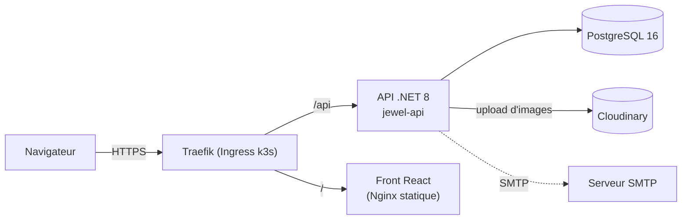
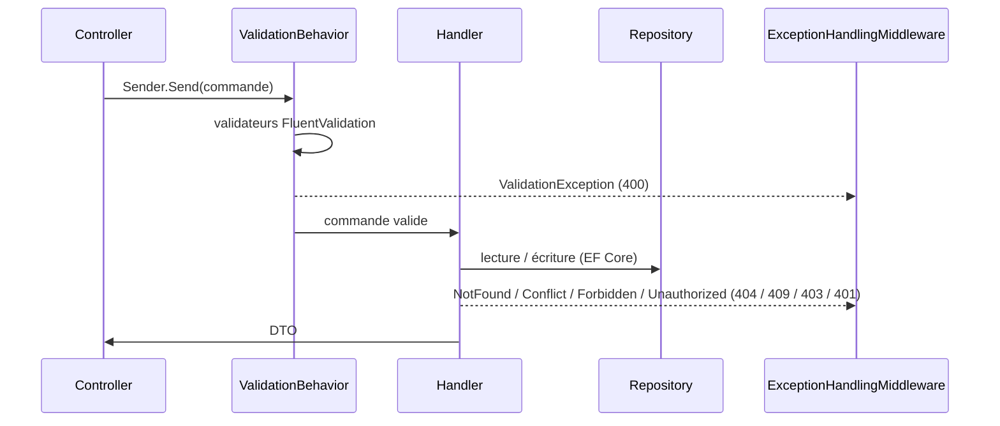
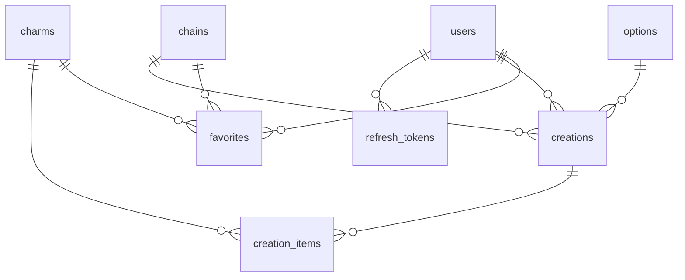
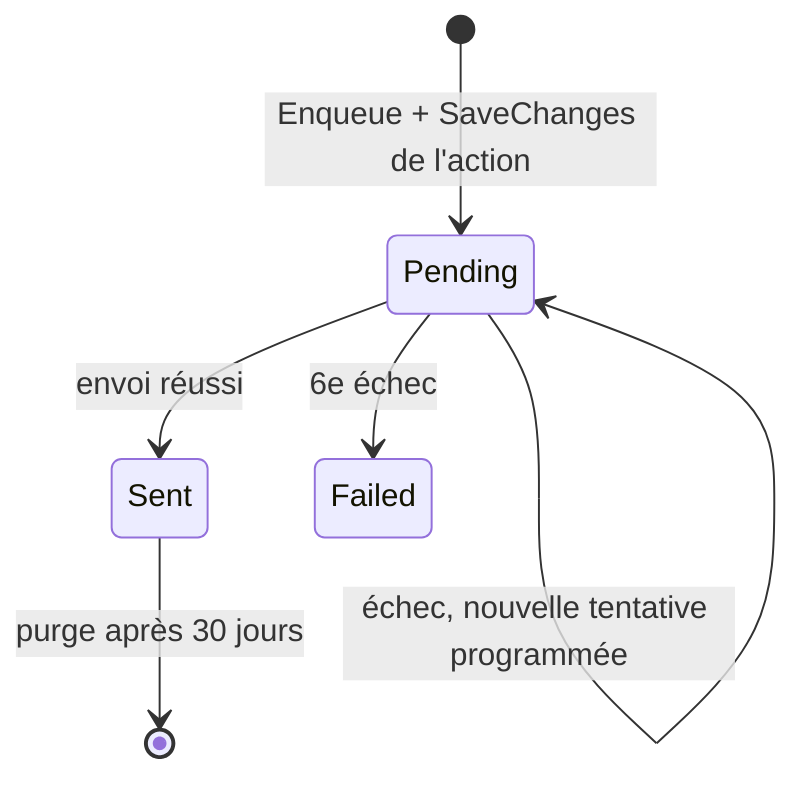
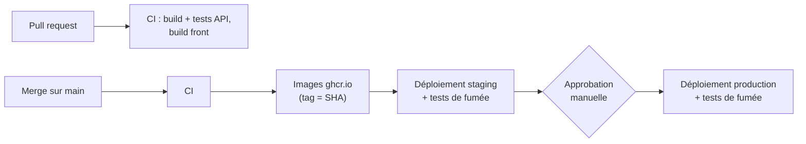
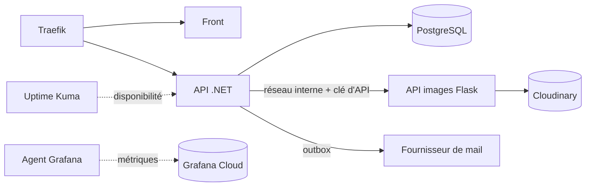

# Architecture de mycharmly

Ce document décrit l'architecture **actuelle** de l'application, puis les **évolutions prévues** par la [roadmap](ROADMAP.md).
Les conventions de code sont dans [`CONTRIBUTING.md`](../CONTRIBUTING.md).

---

## 1. Vue d'ensemble

mycharmly est une application web de création de colliers à breloques. Elle comprend un espace client (catalogue, favoris) et un espace admin (gestion du catalogue, utilisateurs).



| Composant | Rôle | Technologies |
|---|---|---|
| `jewel-front` | Interface client et admin, fichiers statiques servis par Nginx | React 18, TypeScript, Vite, MobX, Tailwind, axios, react-router 6 |
| `jewel-api` | API REST, logique métier, authentification | .NET 8, ASP.NET Core, MediatR, FluentValidation, EF Core (Npgsql), Evolve, BCrypt, JWT, MailKit, Scriban |
| PostgreSQL | Données de l'application | PostgreSQL 16 |
| Cloudinary | Stockage et diffusion des images produit | service externe |

Le front et l'API partagent le même domaine : le front appelle des URL relatives (`/api/...`) et la passerelle route `/api/` vers l'API et le reste vers le front.

---

## 2. API (`jewel-api`)

### Organisation en tranches verticales

Un seul projet, `JewelryShop.API`, organisé **par fonctionnalité** :

```
src/JewelryShop.API/
├── Program.cs                     # chargement du .env, migrations, démarrage
├── Startup.cs                     # injection de dépendances et pipeline HTTP
├── Application/
│   ├── Common/                    # ApiControllerBase, BaseEntity, PagedResult, exceptions,
│   │                              # ValidationBehavior, Repository<T>, interfaces de services
│   └── Features/<Fonctionnalité>/ # entité, repository, controller, Commands/, Queries/, DTOs/
└── Infrastructure/
    ├── BackgroundJobs/            # PeriodicJobsService (planificateur des IPeriodicJob)
    ├── Middlewares/               # ExceptionHandlingMiddleware
    ├── Email/                     # EmailOptions, SmtpEmailSender (MailKit), ScribanEmailTemplateRenderer, EmailQueue, Templates/
    ├── Persistence/               # AppDbContext, Configurations/ (mapping EF)
    └── Services/                  # JwtService, BcryptPasswordHasher, SecureTokenGenerator, CloudinaryFileStorageService
```

Fonctionnalités existantes : `Auth`, `Admin`, `Users`, `Chains`, `Charms`, `Favorites`, `Creations`, `Options`, `Emails` (outbox, sans endpoint).

### Traitement d'une requête



- Le controller ne fait que traduire la requête HTTP en commande MediatR.
- Le `ValidationBehavior` exécute tous les validateurs avant le handler.
- Les erreurs métier sont des exceptions typées, converties par le middleware en JSON `{ status, title, errors }`. Les 4xx sont journalisées en `Information`, les 5xx en `Error`.

### Authentification et autorisation

- `POST /api/auth/register` et `POST /api/auth/login` renvoient un **JWT** (HS256, valable `Jwt__ExpiresInDays` jours, 7 aujourd'hui) avec l'identifiant (`sub`) et le rôle, et posent le refresh token en cookie (voir ci-dessous).
- Mots de passe hachés avec BCrypt. Rôles : `User` et `Admin` (`UserRole`).
- Les endpoints admin portent `[Authorize(Roles = "Admin")]`. `AdminController` regroupe les routes `api/admin/...`.
- L'inscription est **publique** aujourd'hui.

### Refresh tokens

- **Cookie** `refresh_token` (`RefreshTokenCookie`) : `HttpOnly`, `Secure`, `SameSite=Strict`, `Path=/api/auth`, `Max-Age` de 30 jours. Le refresh token n'apparaît jamais dans un corps de réponse : les handlers renvoient un `AuthResult` interne et le controller pose le cookie. `localhost` et `127.0.0.1` étant des contextes sécurisés, le cookie `Secure` fonctionne aussi en local en HTTP. La politique CORS autorise les credentials, pour que le front appelle l'API en dev sur un autre port.
- **Endpoints** (anonymes, sans corps) :
  - `POST /api/auth/refresh` : 200 avec un nouvel `AuthResponse` et un nouveau cookie (rotation). 401 « Votre session a expiré. Veuillez vous reconnecter. » si le cookie est absent, inconnu, expiré, révoqué ou réutilisé : le cookie est alors supprimé ;
  - `POST /api/auth/logout` : 204. Révoque le token s'il est actif et supprime le cookie dans tous les cas.
- Le front ne les utilise pas encore (#31).

- **Tokens opaques** : `ISecureTokenGenerator` (`SecureTokenGenerator`, singleton) génère 32 octets aléatoires en base64url (43 caractères) et les hache en SHA-256 hexadécimal. Seul le hash est stocké dans `refresh_tokens.token_hash`. Le token en clair n'est ni enregistré ni journalisé. Le même générateur servira à la réinitialisation du mot de passe (#33) et aux invitations (#35).
- **`IRefreshTokenService`** (`Features/Auth/`) :
  - `Issue(user)` ajoute un token valable 30 jours (`RefreshTokenDefaults.Lifetime`), **sans sauvegarder** : il est enregistré par le `SaveChangesAsync` de l'appelant ;
  - `RotateAsync(token)` marque le token comme tourné (`rotated_at`), en émet un nouveau valable 30 jours à partir de maintenant (expiration glissante), puis sauvegarde ;
  - `RevokeAsync(token)` révoque un token actif et sauvegarde ;
  - `RevokeAllForUserAsync(userId)` révoque tous les tokens actifs de l'utilisateur, sans sauvegarder.
- **Détection de réutilisation** : présenter un token déjà tourné révoque toutes les sessions de l'utilisateur, sur tous ses appareils, et journalise un warning avec son id. Un token inconnu, expiré, révoqué ou réutilisé lève une `UnauthorizedException` (401) « Votre session a expiré. Veuillez vous reconnecter. ».
- Un token est **actif** s'il n'est ni tourné, ni révoqué, ni expiré. Les tokens tournés ou révoqués restent en base jusqu'à leur expiration, pour que la réutilisation reste détectable.

### Données



| Table | Contenu |
|---|---|
| `users` | nom, prénom, email (unique), hash du mot de passe, date de naissance, rôle |
| `chains` | chaîne : nom, description, couleur, image, lien, coût, prix, longueur (`numeric(6,2)`) |
| `charms` | breloque : mêmes champs, avec un stock en unités au lieu de la longueur |
| `options` | longueurs proposées (nom, longueur `numeric(6,2)`) |
| `favorites` | favori d'un utilisateur : exactement une chaîne **ou** une breloque (contrainte `CHECK`) |
| `creations`, `creation_items` | création d'un utilisateur : une chaîne, une option, des breloques positionnées |
| `email_outbox` | mails à envoyer : destinataire, sujet, corps HTML et texte, statut, tentatives, prochaine tentative, dernière erreur |
| `refresh_tokens` | refresh token d'un utilisateur : hash SHA-256 (unique), création, expiration, rotation, révocation. Supprimé avec l'utilisateur |

- Le schéma est créé par des **migrations SQL Evolve** (`jewel-api/db/migrations/V<n>__*.sql`). EF Core ne sert que d'ORM. Son mapping (`Infrastructure/Persistence/Configurations/`) reprend le schéma en snake_case.
- `IsEraseDisabled = true` empêche Evolve d'effacer la base. `EnableClusterMode` pose un verrou Postgres pour que deux instances ne migrent pas en même temps.
- Les migrations sont jouées au démarrage en local (`Database__MigrateOnStartup`, `true` par défaut) et par la commande `dotnet JewelryShop.API.dll --migrate` en déploiement.

### Envoi de mails

- `IEmailSender` (`Application/Common/Interfaces`) envoie un `EmailMessage` (destinataire, sujet, corps HTML et texte) et lève une exception si l'envoi échoue.
- Une seule implémentation, `SmtpEmailSender` (MailKit) : Mailpit en local, relais SMTP du fournisseur en staging et en production. Une connexion par envoi, STARTTLS si `Email__Smtp__UseSsl`, authentification seulement si `Email__Smtp__Username` est renseigné.
- Configuration `Email__*` facultative : sans `Email__Smtp__Host`, l'API démarre et journalise un warning.
- Les fonctionnalités n'appellent pas `IEmailSender` directement : elles passent par l'outbox (ci-dessous).

### Outbox et envoi asynchrone

Une action métier ne doit jamais échouer parce que le serveur de mail est indisponible. Le mail est donc écrit en base avec l'action, puis envoyé en arrière-plan.

1. **Mise en file** : `IEmailQueue.Enqueue(to, templateName, model)` rend le template et ajoute une ligne `Pending` à `email_outbox`, **sans sauvegarder**. Le mail est enregistré par le `SaveChangesAsync` de l'action, dans la même transaction : si l'action échoue, aucun mail n'est mis en file.
2. **Envoi** (`EmailOutboxDispatchJob`, toutes les 10 s) : dans une transaction, verrouille jusqu'à 20 mails `Pending` dont `next_attempt_at` est passé (`FOR UPDATE SKIP LOCKED`, pour que deux instances de l'API, par exemple pendant un déploiement, ne prennent pas les mêmes lignes), les envoie un par un puis enregistre leur nouvel état.
3. **Nouvelles tentatives** (`EmailOutboxRetryPolicy`) : un envoi initial, puis 5 nouvelles tentatives après 1, 5, 15, 60 et 240 minutes. Chaque échec incrémente `attempts` et garde le message d'erreur (2 000 caractères au plus) dans `last_error`. Après le 6ᵉ échec, le mail passe à `Failed` (warning journalisé avec son id, sans son contenu) et n'est plus retenté.
4. **Purge** (`EmailOutboxPurgeJob`, toutes les heures) : supprime les mails `Sent` depuis plus de 30 jours. Les mails `Failed` sont conservés pour analyse.



- Sans `Email__Smtp__Host`, la tâche d'envoi ne fait rien : les mails restent `Pending` avec `attempts = 0` et partent dès que l'envoi est configuré.
- **Au moins une fois** : les envois ont lieu avant la validation de la transaction. Si la validation échoue après un envoi réussi (ou si la stratégie de reprise d'EF rejoue le bloc), le mail repart au tour suivant. Un doublon est possible, une perte non.
- **Dates** : les colonnes sont en `timestamp` sans fuseau et contiennent de l'UTC. L'application écrit `DateTime.UtcNow` (via `TimeProvider`) et les requêtes comparent avec `NOW()` : la session Postgres doit être en UTC (valeur par défaut de l'image officielle).

### Tâches périodiques

- `PeriodicJobsService` (`BackgroundService`) se réveille toutes les 10 s et exécute chaque `IPeriodicJob` dont l'intervalle (`Interval`) est écoulé, chacune dans son propre scope DI.
- L'exception d'une tâche est journalisée en `Error` : elle n'arrête ni la boucle ni les autres tâches.
- Une nouvelle tâche s'enregistre avec `services.AddScoped<IPeriodicJob, MaTache>()`. Tâches actuelles : `EmailOutboxDispatchJob`, `EmailOutboxPurgeJob` et `RefreshTokenPurgeJob` (toutes les heures, supprime les refresh tokens expirés). La purge des tokens de réinitialisation (#33) et l'expiration des invitations (#35) s'y ajouteront.
- Les tâches tournent dans chaque instance de l'API : une tâche doit supporter d'être exécutée en parallèle par deux pods (verrou de ligne, requête idempotente).
- Le mode `--migrate` ne démarre pas le serveur, donc pas les tâches.

### Templates de mail

- `IEmailTemplateRenderer` (`Application/Common/Interfaces`) produit un `RenderedEmail` (sujet, HTML, texte) à partir d'un nom de template et d'un modèle. Implémentation : `ScribanEmailTemplateRenderer` (Scriban), enregistrée en singleton.
- **Trois fichiers par mail**, dans `Infrastructure/Email/Templates/`, embarqués dans l'assembly (`<EmbeddedResource>` du `.csproj`) : `<Nom>.subject.sbn`, `<Nom>.html.sbn`, `<Nom>.txt.sbn`. Le nom est une constante de `EmailTemplates` (`EmailTemplates.Test` sert seulement aux tests), jamais une chaîne en dur.
- Les propriétés du modèle sont exposées en snake_case : `FirstName` devient `{{ first_name }}`.
- **Échappement** : dans un `.html.sbn`, chaque variable est échappée avec `| html.escape` (`{{ first_name | html.escape }}`). Le sujet et le texte ne sont pas échappés.
- Le sujet rendu est ramené sur une seule ligne, sans espaces autour (c'est un en-tête SMTP).
- Chaque template est parsé une seule fois puis gardé en cache. Un template introuvable, une erreur de syntaxe ou une variable absente du modèle lèvent une `InvalidOperationException` qui nomme le template.

### Santé

- `GET /health/live` : le processus répond.
- `GET /health/ready` : la base répond. Utilisé par le `HEALTHCHECK` Docker et les sondes Kubernetes.

---

## 3. Front (`jewel-front`)

```
src/
├── api/          # client axios (Bearer token injecté), une fonction par endpoint, types des DTO
├── stores/       # MobX : AuthStore, ProductAdminStore, FavoritesStore, RootStore + hooks d'accès
├── routes/       # guards.tsx : ProtectedRoute, AdminRoute
├── pages/        # pages routées : AuthPage, user/, admin/
├── features/     # composants métier : admin/, auth/, products/, favorites/, user/
├── components/ui # composants génériques (Button, TextField, Pagination…)
├── hooks/        # useAsync
└── lib/          # cn, format, jwt (décodage des claims côté client), returnUrl (redirection après connexion),
                  # passwordPolicy (règles du mot de passe, identiques au back)
```

- Routage déclaré dans `App.tsx`. `/login` est public. L'espace client (`/charms`, `/chains`, `/favorites`) exige une session. `/admin/...` exige le rôle `Admin`.
- Le JWT est stocké dans `localStorage` et restauré au chargement (`AuthStore.hydrate`). Un token expiré est supprimé.
- `VITE_API_URL` est figée **au build**. Vide en production : URL relatives.
- Les validations de formulaire reprennent celles du back (`features/products/productForm.ts`, `lib/passwordPolicy.ts`).

---

## 4. Infrastructure et déploiement

### Environnement local

- `compose.yaml` (racine) : toute l'application (Postgres, API, front, passerelle Nginx sur `127.0.0.1:8090`, pgAdmin sur `127.0.0.1:8092`, Mailpit sur `127.0.0.1:8025`). La base est sur un réseau Docker interne, sans port publié.
- `jewel-api/docker-compose.yml` : Postgres seul (port 5433), pgAdmin et Mailpit (SMTP sur `127.0.0.1:1025`, interface sur `127.0.0.1:8025`), pour lancer l'API et le front hors Docker.
- Mailpit capture les mails envoyés par l'API : rien ne part vers l'extérieur.

### Production et staging

- Un **VPS OVH** (2 vCores, 4 Go de RAM, 40 Go de disque, partagé avec une autre application) avec **k3s**. Traefik sert d'Ingress, cert-manager fournit les certificats HTTPS.
- Manifests **Kustomize** dans `deploy/k8s/` :
  - `base/` : Postgres (StatefulSet), configuration et Job de migration de l'API, Deployments de l'API et du front, redirection HTTPS, NetworkPolicies ;
  - `overlays/staging` (namespace `jewel-staging`, https://staging.mycharmly.eu, protégé par authentification basique ; l'API y tourne dans l'environnement ASP.NET Core `Staging`, qui expose Swagger sous `/api/swagger`) ;
  - `overlays/production` (namespace `jewel-prod`, https://mycharmly.eu) : en plus, pgAdmin et la sauvegarde Postgres en CronJob ;
  - `platform/` : namespaces, StorageClass `Retain`, cert-manager, compte de service de déploiement GitHub.
- **NetworkPolicies** : tout flux entrant est refusé par défaut. Seuls sont autorisés Traefik vers le front, l'API et le solveur ACME, et les clients déclarés vers Postgres. Postgres n'a aucun flux sortant.
- Configuration : non secrète dans le ConfigMap `api-config`, secrète dans les Secrets alimentés depuis les environnements GitHub (`apply-secrets.sh`).

### CI/CD



Chaque déploiement (`deploy-k8s.yml`) suit le même ordre :

1. mise à jour des Secrets ;
2. socle (configuration, services, Postgres) ;
3. **sauvegarde de la base** (production uniquement) ;
4. **Job de migration**. En cas d'échec, les applications ne sont pas mises à jour ;
5. déploiement de l'API et du front, avec `rollout undo` automatique si un Deployment ne démarre pas ;
6. tests de fumée sur `/` et `/api/chains`, avec retour arrière automatique en cas d'échec.

Le retour arrière remet l'ancienne version du code, **pas l'ancien schéma** : c'est pourquoi les migrations doivent être rétrocompatibles (voir `CONTRIBUTING.md` §6).

---

## 5. Évolutions prévues par la roadmap

### v0.1 : socle auth et accès

| Sujet | Impact sur l'architecture |
|---|---|
| Service d'email | Fait : interface `IEmailSender` et envoi SMTP `SmtpEmailSender` (Mailpit en dev ; relais SMTP du fournisseur en prod, configuré par #26). Templates Scriban côté back (`IEmailTemplateRenderer`). Table **outbox** et `PeriodicJobsService` d'envoi : premier traitement asynchrone de l'API. À venir : nouveau flux sortant vers le fournisseur de mail (NetworkPolicy à prévoir, #26). |
| Politique de mot de passe | Fait côté back : la règle FluentValidation réutilisable `PasswordPolicy()` (`Features/Auth/Validation/PasswordPolicyRules.cs`) est appliquée à l'inscription, et le sera à la réinitialisation. La connexion ne l'applique pas, pour ne pas bloquer les comptes existants. Le front reprend les mêmes règles et messages (`lib/passwordPolicy.ts`) et les affiche cochées en direct à l'inscription (`features/auth/PasswordRules`). |
| Refresh token | Access token JWT de 15 min (au lieu de 7 jours). Nouvelle table de refresh tokens hachés, cookie `httpOnly` `Secure` `SameSite=Strict`, rotation et détection de réutilisation. Front : intercepteur axios (401 → refresh → rejeu, file d'attente). Le stockage du token d'accès dans `localStorage` est à revoir. |
| Protection des routes front | Fait : les guards `ProtectedRoute` / `AdminRoute` redirigent vers `/login?returnUrl=…`, et `AuthPage` renvoie sur la page demandée après connexion si le chemin est interne et autorisé pour le rôle. |
| Mot de passe oublié | Table de tokens de réinitialisation hachés, à usage unique. Révocation des refresh tokens. |
| Inscription sur invitation | Table `Invitation`. `POST /api/auth/register` devient conditionné par une invitation valide. C'est un **changement de comportement** de l'endpoint public existant. |
| Gestion des utilisateurs | `GET /api/admin/users` existe. Ajout des invitations et d'une page admin « Utilisateurs ». |

### v0.2 : création de collier et commandes

| Sujet | Impact sur l'architecture |
|---|---|
| Modèle catalogue | `chains` passe d'un prix et d'une longueur à un **coût et prix au mètre**, un **stock en cm entiers** et un **coût et prix de fermoir**. Migration de données sur les lignes existantes (`length numeric` → stock en cm). Nouvelle table de référence `ChainLength`, à articuler avec la table `options` existante. Calcul du prix côté back. |
| Adresse de livraison | Champs d'adresse sur `users` (nullables), copiés dans la commande. |
| Parcours de création | Parcours front en étapes, état côté front uniquement, drag and drop (dnd-kit, nouvelle dépendance). Maximum 8 breloques vérifié des deux côtés. À articuler avec les entités `Creation` / `CreationItem` existantes. |
| Commandes | Nouvelles tables `Order`, `OrderLine` (prix copiés, position des breloques), `OrderStatusHistory`, `OrderNote`. Machine à états côté back. Mouvements de stock dans la même transaction que la commande. Mails via l'outbox de la v0.1. |

### v0.3 : supervision et traitement des images

| Sujet | Impact sur l'architecture |
|---|---|
| Health checks | `/health/live` et `/health/ready` existent déjà côté .NET. Ajout d'un endpoint de santé sur l'API images. Uptime Kuma pour la disponibilité et les alertes. |
| Métriques | OpenTelemetry côté .NET, `prometheus-flask-exporter` côté Flask. Envoi vers Grafana Cloud par un agent léger sur le VPS, pour économiser RAM et disque. |
| API images | Nouveau service **Python Flask** (Pillow, rembg + onnxruntime, cloudinary, gunicorn à un seul worker), interne au cluster : pas d'Ingress, clé d'API, NetworkPolicy autorisant uniquement l'API .NET. Nouveau Deployment, nouvelle image ghcr.io et nouveau job de CI. Consommation mémoire du modèle rembg à surveiller sur 4 Go partagés. |
| Intégration admin | À l'upload, l'API .NET appelle l'API images puis stocke l'URL et le `public_id` Cloudinary (nouvelle colonne). Écran de validation du détourage. |


