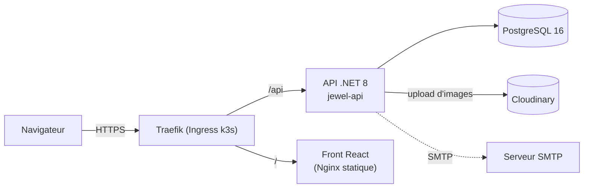
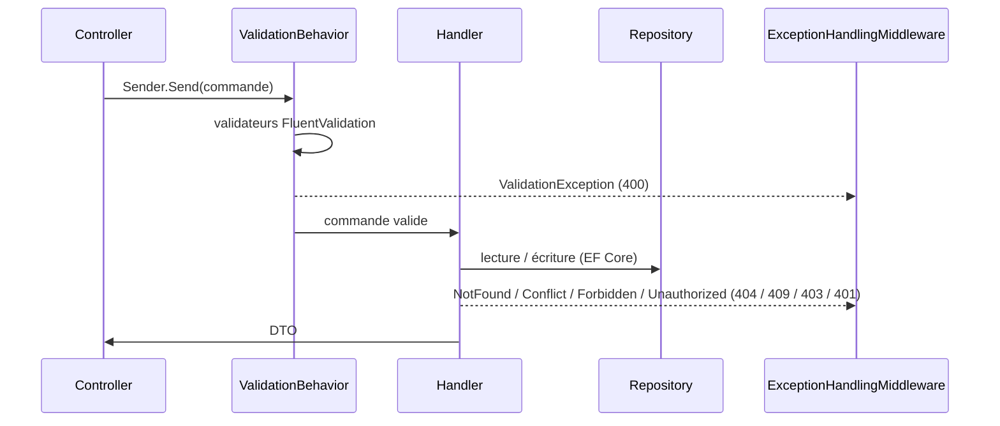
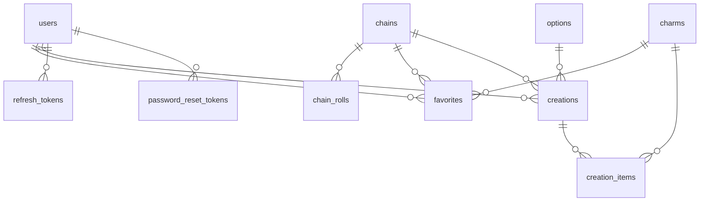
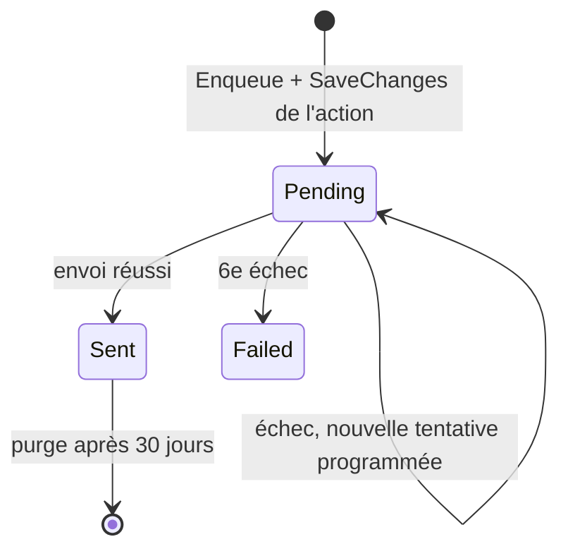
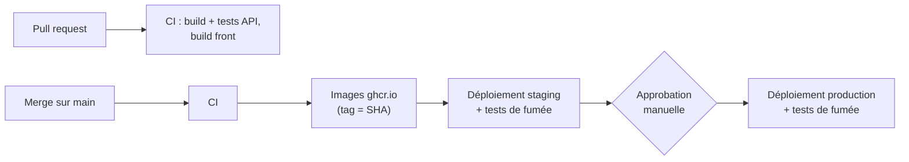
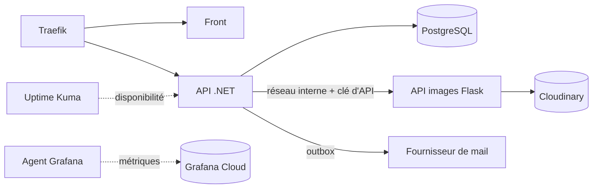

# Architecture de mycharmly

Ce document décrit l'architecture **actuelle** de l'application, puis les **évolutions prévues** par la [roadmap](ROADMAP.md).
Les conventions de code sont dans [`CONTRIBUTING.md`](../CONTRIBUTING.md).

---

## 1. Vue d'ensemble

mycharmly est une application web de création de colliers à breloques. Elle comprend un espace client (catalogue, favoris) et un espace admin (gestion du catalogue, utilisateurs).



| Composant | Rôle | Technologies |
|---|---|---|
| `jewel-front` | Interface client et admin, fichiers statiques servis par Nginx | React 18, TypeScript, Vite, MobX, Tailwind, axios, react-router 6 |
| `jewel-api` | API REST, logique métier, authentification | .NET 8, ASP.NET Core, MediatR, FluentValidation, EF Core (Npgsql), Evolve, BCrypt, JWT, MailKit, Scriban, Coravel |
| PostgreSQL | Données de l'application | PostgreSQL 16 |
| Cloudinary | Stockage et diffusion des images produit | service externe |

Le front et l'API partagent le même domaine : le front appelle des URL relatives (`/api/...`) et la passerelle route `/api/` vers l'API et le reste vers le front.

---

## 2. API (`jewel-api`)

### Organisation en tranches verticales

Un seul projet, `JewelryShop.API`, organisé **par fonctionnalité** :

```
src/JewelryShop.API/
├── Program.cs                     # chargement du .env, migrations, démarrage
├── Startup.cs                     # injection de dépendances et pipeline HTTP
├── Common/                        # ApiControllerBase, BaseEntity, PagedResult, exceptions,
│                                  # ValidationBehavior, Repository<T>, interfaces de services,
│                                  # Validation/ImageFileRules (règles des images uploadées)
├── Features/<Fonctionnalité>/     # Entities/, Repositories/, Controllers/, Commands/, Queries/,
│                                  # Validators/, DTOs/, Common/ (code partagé de la fonctionnalité)
└── Infrastructure/
    ├── Middlewares/               # ExceptionHandlingMiddleware
    ├── Email/                     # EmailOptions, SmtpEmailSender (MailKit), ScribanEmailTemplateRenderer, EmailQueue, Templates/
    ├── Persistence/               # AppDbContext, Configurations/ (mapping EF)
    └── Services/                  # JwtService, BcryptPasswordHasher, SecureTokenGenerator, RefreshTokenService,
                                   # CloudinaryFileStorageService
```

Fonctionnalités existantes : `Auth`, `Admin`, `Users`, `Chains`, `Charms`, `Favorites`, `Creations`, `Options`, `Emails` (outbox, sans endpoint).

### Traitement d'une requête



- Le controller ne fait que traduire la requête HTTP en commande MediatR.
- Le `ValidationBehavior` exécute tous les validateurs avant le handler.
- Les erreurs métier sont des exceptions typées, converties par le middleware en JSON `{ status, title, errors }`. Les 4xx sont journalisées en `Information`, les 5xx en `Error`.
- **Upload d'image** (`POST /api/chains/{id}/image`, `POST /api/charms/{id}/image`) : les validateurs appliquent `ImageFileRules` (`Common/Validation/`). Un fichier absent ou vide donne « Aucun fichier fourni. ». Sinon, le type MIME doit être `image/jpeg`, `image/png` ou `image/webp` (« Le fichier doit être une image JPEG, PNG ou WEBP. »), l'extension doit correspondre au type (`.jpg` ou `.jpeg`, `.png`, `.webp`, sans tenir compte de la casse : « L'extension du fichier ne correspond pas à son format. ») et la taille ne doit pas dépasser 5 Mo (« L'image ne doit pas dépasser 5 Mo. »). Toutes ces erreurs sont des 400 sous la clé `File`.
- **Listes du catalogue** (`GET /api/chains`, `GET /api/charms`, anonymes) : paginées et triées par id. Avec `favoritesFirst=true`, les favoris de l'utilisateur connecté passent en tête, puis les autres produits, chaque groupe trié par id. Le tri s'applique après les filtres et avant la pagination. Le paramètre est ignoré pour un appel anonyme (sans token, ou avec un token invalide ou expiré), qui garde l'ordre habituel.

### Authentification et autorisation

- `POST /api/auth/register` et `POST /api/auth/login` renvoient un **JWT** (HS256, valable `Jwt__AccessTokenMinutes` minutes, 15 par défaut ; tolérance d'horloge `ClockSkew` de 30 secondes à la validation) avec l'identifiant (`sub`) et le rôle, et posent le refresh token en cookie (voir ci-dessous).
- Mots de passe hachés avec BCrypt. Rôles : `User` et `Admin` (`UserRole`).
- Les endpoints admin portent `[Authorize(Roles = "Admin")]`. `AdminController` regroupe les routes `api/admin/...`.
- **Champs réservés aux admins** : `GET /api/chains` et `GET /api/charms` (liste et détail) restent anonymes, mais le lien fournisseur (`url`) et les coûts (`cost`, et pour une chaîne `costPerMeter` et `claspCost`) ne sont renvoyés qu'à un appelant dont le token porte le rôle `Admin` (`ApiControllerBase.IsAdmin`). Les DTO publics (`ChainDto`, `CharmDto`) et admin (`AdminChainDto`, `AdminCharmDto`, qui en héritent) sont dans le même fichier ; le DTO public déclare le DTO admin avec `[JsonDerivedType]` pour que la sérialisation garde ses champs dans un `PagedResult<ChainDto>`. La création et la modification renvoient le DTO admin. Les favoris embarquent toujours le DTO public.
- L'inscription est **fermée au public** : un compte ne se crée que sur invitation.
- **Inscription sur invitation** :
  - `GET /api/auth/invitations/{token}` (anonyme) : 200 `{ email, expiresAt }` si l'invitation est en attente et non expirée. Sinon (inconnue, expirée, révoquée ou acceptée), 404 « Cette invitation est invalide ou a expiré. », sans distinguer les cas ;
  - `POST /api/auth/register` exige le champ `invitationToken` : absent ou vide, il donne un 400 sur `InvitationToken` (« Une invitation est nécessaire pour créer un compte. ») et aucun compte n'est créé. Le champ `email` du corps reste accepté pour ne pas casser d'anciens clients, mais il est ignoré : le compte prend l'email de l'invitation, avec le rôle `User`. Une invitation inconnue, expirée, révoquée ou déjà acceptée donne un 400 sur `InvitationToken` (« Cette invitation est invalide ou a expiré. »), un compte existant pour l'email un 409. L'invitation passe à `Accepted` (`accepted_at`, `accepted_user_id`) dans la même sauvegarde que le compte et le refresh token.

### Mot de passe oublié

- **Endpoints** (anonymes) :
  - `POST /api/auth/forgot-password` `{ email }` : 202 sans corps, que l'email soit inscrit ou non, pour ne pas révéler les comptes existants. 400 si l'email est vide ou mal formé. Pour un compte existant, supprime ses tokens non utilisés, en crée un nouveau valable 1 heure (`PasswordResetTokenDefaults.Lifetime`) et met en file le mail `PasswordReset`, avec le lien `{App__FrontendBaseUrl}/reset-password?token=…`, dans une seule sauvegarde ;
  - `POST /api/auth/reset-password` `{ token, password }` : 204. Applique `PasswordPolicy()` au nouveau mot de passe, marque le token utilisé (`used_at`) et révoque tous les refresh tokens de l'utilisateur. 400 « Ce lien de réinitialisation est invalide ou a expiré. » (clé `Token`) si le token est vide, inconnu, déjà utilisé ou expiré.
- Le token est opaque (`ISecureTokenGenerator`), à usage unique, et seul son hash est stocké dans `password_reset_tokens.token_hash`.
- Ces endpoints n'ont pas de limitation de débit.

### Refresh tokens

- **Cookie** `refresh_token` (`RefreshTokenCookie`) : `HttpOnly`, `Secure`, `SameSite=Strict`, `Path=/api/auth`, `Max-Age` de 30 jours. Le refresh token n'apparaît jamais dans un corps de réponse : les handlers renvoient un record interne (`RegisterResult`, `LoginResult` ou `RefreshSessionResult`, dérivés de l'`AuthResult` abstrait de `Features/Auth/Common/`), et le controller pose le cookie. `localhost` et `127.0.0.1` étant des contextes sécurisés, le cookie `Secure` fonctionne aussi en local en HTTP. La politique CORS autorise les credentials, pour que le front appelle l'API en dev sur un autre port.
- **Endpoints** (anonymes, sans corps) :
  - `POST /api/auth/refresh` : 200 avec un nouvel `AuthResponse` et un nouveau cookie (rotation). 401 « Votre session a expiré. Veuillez vous reconnecter. » si le cookie est absent, inconnu, expiré, révoqué ou réutilisé : le cookie est alors supprimé ;
  - `POST /api/auth/logout` : 204. Révoque le token s'il est actif et supprime le cookie dans tous les cas.
- Le front les utilise pour garder la session ouverte (voir « Stockage du token » dans la partie Front).

- **Tokens opaques** : `ISecureTokenGenerator` (`SecureTokenGenerator`, singleton) génère 32 octets aléatoires en base64url (43 caractères) et les hache en SHA-256 hexadécimal. Seul le hash est stocké dans `refresh_tokens.token_hash`. Le token en clair n'est ni enregistré ni journalisé. Le même générateur sert à la réinitialisation du mot de passe (`password_reset_tokens`) et aux invitations (`invitations`).
- **`IRefreshTokenService`** (`Infrastructure/Services/`) :
  - `Issue(user)` ajoute un token valable 30 jours (`RefreshTokenDefaults.Lifetime`), **sans sauvegarder** : il est enregistré par le `SaveChangesAsync` de l'appelant ;
  - `RotateAsync(token)` marque le token comme tourné (`rotated_at`), en émet un nouveau valable 30 jours à partir de maintenant (expiration glissante), puis sauvegarde ;
  - `RevokeAsync(token)` révoque un token actif et sauvegarde ;
  - `RevokeAllForUserAsync(userId)` révoque tous les tokens actifs de l'utilisateur, sans sauvegarder.
- **Détection de réutilisation** : présenter un token déjà tourné révoque toutes les sessions de l'utilisateur, sur tous ses appareils, et journalise un warning avec son id. Un token inconnu, expiré, révoqué ou réutilisé lève une `UnauthorizedException` (401) « Votre session a expiré. Veuillez vous reconnecter. ».
- Un token est **actif** s'il n'est ni tourné, ni révoqué, ni expiré. Les tokens tournés ou révoqués restent en base jusqu'à leur expiration, pour que la réutilisation reste détectable.

### Données



| Table | Contenu |
|---|---|
| `users` | nom, prénom, email (unique), hash du mot de passe, date de naissance, rôle, date d'inscription (`created_at`, UTC, `NULL` pour les comptes créés avant son ajout) |
| `chains` | chaîne : nom, description, couleur, image, lien, coût et prix au mètre, coût et prix du fermoir (`0` par défaut). Les anciennes colonnes coût, prix et longueur (`numeric(6,2)`) restent remplies par l'ancien format de l'API et sont vides pour une chaîne créée au nouveau format |
| `chain_rolls` | rouleau d'une chaîne : longueur initiale et longueur restante en cm entiers, date d'ajout. Supprimé avec la chaîne. Le stock d'une chaîne (`stockCm`) est la somme des longueurs restantes |
| `charms` | breloque : mêmes champs, avec un stock en unités au lieu de la longueur |
| `options` | longueurs proposées (nom, longueur `numeric(6,2)`) |
| `favorites` | favori d'un utilisateur : exactement une chaîne **ou** une breloque (contrainte `CHECK`) |
| `creations`, `creation_items` | création d'un utilisateur : une chaîne, une option, des breloques positionnées |
| `email_outbox` | mails à envoyer : destinataire, sujet, corps HTML et texte, statut, tentatives, prochaine tentative, dernière erreur |
| `refresh_tokens` | refresh token d'un utilisateur : hash SHA-256 (unique), création, expiration, rotation, révocation. Supprimé avec l'utilisateur |
| `password_reset_tokens` | token de réinitialisation du mot de passe : hash SHA-256 (unique), création, expiration, utilisation. Supprimé avec l'utilisateur |

- Le schéma est créé par des **migrations SQL Evolve** (`jewel-api/db/migrations/V<n>__*.sql`). EF Core ne sert que d'ORM. Son mapping (`Infrastructure/Persistence/Configurations/`) reprend le schéma en snake_case.
- `IsEraseDisabled = true` empêche Evolve d'effacer la base. `EnableClusterMode` pose un verrou Postgres pour que deux instances ne migrent pas en même temps.
- Les migrations sont jouées au démarrage en local (`Database__MigrateOnStartup`, `true` par défaut) et par la commande `dotnet JewelryShop.API.dll --migrate` en déploiement.

### Envoi de mails

- `IEmailSender` (`Common/Interfaces`) envoie un `EmailMessage` (destinataire, sujet, corps HTML et texte) et lève une exception si l'envoi échoue.
- Une seule implémentation, `SmtpEmailSender` (MailKit) : Mailpit en local, relais SMTP de Brevo en staging et en production. Une connexion par envoi, STARTTLS si `Email__Smtp__UseSsl`, authentification seulement si `Email__Smtp__Username` est renseigné.
- Configuration `Email__*` facultative. L'envoi n'est configuré que si `Email__Enabled` vaut `true` (`false` par défaut) **et** si `Email__Smtp__Host` est renseigné. Sinon, l'API démarre et journalise un warning, et aucun envoi n'est tenté. En local, `compose.yaml` et `jewel-api/.env.example` posent `Email__Enabled=true` pour Mailpit.
- `App__FrontendBaseUrl` : URL publique du front, pour construire les liens des mails, lue par `AppOptions` (`http://localhost:5173` par défaut ; hors développement, son absence est journalisée en warning).
- Les fonctionnalités n'appellent pas `IEmailSender` directement : elles passent par l'outbox (ci-dessous).

### Outbox et envoi asynchrone

Une action métier ne doit jamais échouer parce que le serveur de mail est indisponible. Le mail est donc écrit en base avec l'action, puis envoyé en arrière-plan.

1. **Mise en file** : `IEmailQueue.Enqueue(to, templateName, model)` rend le template et ajoute une ligne `Pending` à `email_outbox`, **sans sauvegarder**. Le mail est enregistré par le `SaveChangesAsync` de l'action, dans la même transaction : si l'action échoue, aucun mail n'est mis en file.
2. **Envoi** (`EmailOutboxDispatchJob`, toutes les 10 s) : dans une transaction, verrouille jusqu'à 20 mails `Pending` dont `next_attempt_at` est passé (`FOR UPDATE SKIP LOCKED`, pour que deux instances de l'API, par exemple pendant un déploiement, ne prennent pas les mêmes lignes), les envoie un par un puis enregistre leur nouvel état.
3. **Nouvelles tentatives** (`EmailOutboxRetryPolicy`) : un envoi initial, puis 5 nouvelles tentatives après 1, 5, 15, 60 et 240 minutes. Chaque échec incrémente `attempts` et garde le message d'erreur (2 000 caractères au plus) dans `last_error`. Après le 6ᵉ échec, le mail passe à `Failed` (warning journalisé avec son id, sans son contenu) et n'est plus retenté.
4. **Purge** (`EmailOutboxPurgeJob`, toutes les heures) : supprime les mails `Sent` depuis plus de 30 jours. Les mails `Failed` sont conservés pour analyse.



- Envoi désactivé ou sans `Email__Smtp__Host`, la tâche d'envoi ne fait rien : les mails restent `Pending` avec `attempts = 0` et partent dès que l'envoi est configuré.
- **Au moins une fois** : les envois ont lieu avant la validation de la transaction. Si la validation échoue après un envoi réussi (ou si la stratégie de reprise d'EF rejoue le bloc), le mail repart au tour suivant. Un doublon est possible, une perte non.
- **Dates** : les colonnes sont en `timestamp` sans fuseau et contiennent de l'UTC. L'application écrit `DateTime.UtcNow` (via `TimeProvider`) et les requêtes comparent avec `NOW()` : la session Postgres doit être en UTC (valeur par défaut de l'image officielle).

### Tâches périodiques

- Les tâches sont planifiées par **Coravel**, intégré à l'hôte .NET (ni base ni service externe). Chaque tâche est un invocable (`IInvocable` et `ICancellableInvocable`) rangé dans `Features/<Fonctionnalité>/Jobs/`, résolu dans son propre scope DI à chaque exécution.
- Une nouvelle tâche s'enregistre avec `services.AddTransient<MaTache>()` dans `Startup.AddInfrastructureServices`, et sa fréquence se déclare dans `Startup.SchedulePeriodicJobs` (`UseScheduler`).
- Tâches actuelles :

  | Tâche | Planification |
  |---|---|
  | `EmailOutboxDispatchJob` (envoi des mails en attente) | toutes les 10 s, sans chevauchement (`PreventOverlapping`) : un envoi qui dure plus de 10 s ne démarre pas de seconde exécution dans la même instance |
  | `EmailOutboxPurgeJob` (mails envoyés depuis plus de 30 jours) | au démarrage, puis à chaque heure pile |
  | `RefreshTokenPurgeJob` (refresh tokens expirés) | au démarrage, puis à chaque heure pile |
  | `PasswordResetTokenPurgeJob` (tokens de réinitialisation expirés ou utilisés) | au démarrage, puis à chaque heure pile |
  | `InvitationExpirationJob` (invitations en attente dont l'échéance est passée → `Expired`) | au démarrage, puis à chaque heure pile |
- L'exception d'une tâche est journalisée en `Error` (`OnError`) : elle n'arrête ni le planificateur ni les autres tâches.
- Les tâches tournent dans chaque instance de l'API : une tâche doit supporter d'être exécutée en parallèle par deux pods (verrou de ligne, requête idempotente).
- Le mode `--migrate` ne démarre pas le serveur, donc pas les tâches.

### Templates de mail

- `IEmailTemplateRenderer` (`Common/Interfaces`) produit un `RenderedEmail` (sujet, HTML, texte) à partir d'un nom de template et d'un modèle. Implémentation : `ScribanEmailTemplateRenderer` (Scriban), enregistrée en singleton.
- **Trois fichiers par mail**, dans `Infrastructure/Email/Templates/`, embarqués dans l'assembly (`<EmbeddedResource>` du `.csproj`) : `<Nom>.subject.sbn`, `<Nom>.html.sbn`, `<Nom>.txt.sbn`. Le nom est une constante de `EmailTemplates` (`EmailTemplates.Test` sert seulement aux tests), jamais une chaîne en dur.
- Les propriétés du modèle sont exposées en snake_case : `FirstName` devient `{{ first_name }}`.
- **Échappement** : dans un `.html.sbn`, chaque variable est échappée avec `| html.escape` (`{{ first_name | html.escape }}`). Le sujet et le texte ne sont pas échappés.
- Le sujet rendu est ramené sur une seule ligne, sans espaces autour (c'est un en-tête SMTP).
- Chaque template est parsé une seule fois puis gardé en cache. Un template introuvable, une erreur de syntaxe ou une variable absente du modèle lèvent une `InvalidOperationException` qui nomme le template.

### Santé

- `GET /health/live` : le processus répond.
- `GET /health/ready` : la base répond. Utilisé par le `HEALTHCHECK` Docker et les sondes Kubernetes.

---

## 3. Front (`jewel-front`)

```
src/
├── api/          # client axios, intercepteurs d'auth (Bearer, refresh sur 401), une fonction par endpoint, types des DTO
├── stores/       # MobX : AuthStore, ProductAdminStore, FavoritesStore, RootStore + hooks d'accès
├── routes/       # guards.tsx : ProtectedRoute, AdminRoute
├── pages/        # pages routées : AuthPage, RegisterPage, ForgotPasswordPage, ResetPasswordPage, user/, admin/
├── features/     # composants métier : admin/, auth/, products/, favorites/, user/, users/
├── components/ui # composants génériques (Button, TextField, Pagination…)
├── hooks/        # useAsync
└── lib/          # cn, format, returnUrl (redirection après connexion), sessionExpired (message à la connexion),
                  # passwordPolicy (règles du mot de passe, identiques au back), emailValidation,
                  # passwordReset (messages et erreur de lien), loginMessage (confirmation à la connexion),
                  # invitation (message et erreurs d'invitation), invitationEmail (règles de l'email d'invitation, identiques au back),
                  # invitationActions (statuts filtrables, actions permises par statut et leurs messages),
                  # imageFile (règles des images uploadées, identiques au back)
```

- Routage déclaré dans `App.tsx`. `/login`, `/register`, `/forgot-password` et `/reset-password` sont publics. L'espace client (`/charms`, `/chains`, `/favorites`) exige une session. `/admin/...` exige le rôle `Admin`.
- **Stockage du token** : l'access token (JWT), l'identifiant et le rôle sont gardés **en mémoire** dans `AuthStore`, jamais dans `localStorage` ni `sessionStorage`. Le refresh token reste dans son cookie `httpOnly`, illisible par le JavaScript. L'ancien token `jewelryshop_token` est retiré de `localStorage` au démarrage.
  - **Au chargement**, `AuthStore.restoreSession()` appelle `POST /api/auth/refresh`. Tant que la restauration n'est pas finie (`initializing`), `ProtectedRoute` et `AdminRoute` affichent un `Spinner` au lieu de rediriger. Un échec laisse le visiteur déconnecté, sans message.
  - **Sur un 401** (hors `login`, `register`, `refresh` et `logout`), l'intercepteur de `api/authInterceptors.ts` rafraîchit la session puis rejoue la requête une seule fois. Une requête partie avec un token déjà renouvelé est rejouée sans nouveau refresh.
  - **Un seul refresh à la fois** (`api/singleFlightRefresh.ts`) : les 401 simultanés d'un onglet attendent la même promesse, et les onglets sont sérialisés par le verrou Web Locks `jewelryshop-refresh`. Le cookie étant partagé, l'onglet qui passe en second présente le cookie déjà renouvelé et n'est pas pris pour une réutilisation. Sans Web Locks API, le refresh s'exécute sans verrou.
  - **Échec du refresh** : `AuthStore.expireSession()` vide la session et pose `sessionExpired` ; les guards redirigent vers `/login?returnUrl=…` avec l'état de navigation `{ sessionExpired: true }`, et la page de connexion affiche « Votre session a expiré. Veuillez vous reconnecter. ».
  - **Déconnexion** : `AuthStore.logout()` appelle `POST /api/auth/logout` (erreur ignorée), puis vide la session.
- `VITE_API_URL` est figée **au build**. Vide en production : URL relatives.
- **Mot de passe oublié** : « Mot de passe oublié ? » mène à `/forgot-password`, qui affiche le même message de confirmation que l'email soit inscrit ou non. Le lien du mail ouvre `/reset-password?token=…`. Sans token, ou si l'API refuse le token (400 sur la clé `Token`), la page affiche « Ce lien de réinitialisation est invalide ou a expiré. » et un lien vers `/forgot-password`. Après un 204, elle redirige vers `/login` avec l'état de navigation `{ message }`, affiché en succès au-dessus du formulaire de connexion. Ces pages restent accessibles avec une session ouverte.
- **Inscription sur invitation** : la page de connexion ne propose plus l'inscription. Le lien du mail d'invitation ouvre `/register?token=…`, qui appelle `GET /api/auth/invitations/{token}` au chargement. Sans token, ou sur un 404, la page affiche « Cette invitation est invalide ou a expiré. Demandez une nouvelle invitation à l'administrateur. » et un lien vers `/login`, sans formulaire ; une autre erreur affiche le message de l'API. Sinon, le formulaire affiche l'email de l'invitation en lecture seule et envoie `invitationToken` avec l'inscription. `AuthStore.register()` renvoie `'success'`, `'invalid-invitation'` (400 sur la clé `InvitationToken` : la page réaffiche le message d'invitation invalide) ou `'error'` (message dans `AuthStore.error`). Après un succès, l'utilisateur est connecté et redirigé vers `/`. La page reste accessible avec une session ouverte.
- **Gestion des utilisateurs** (`/admin/users`, entrée « Utilisateurs » du menu admin) : en haut, le formulaire d'invitation (`features/users/InvitationForm`) appelle `POST /api/admin/invitations`. Il affiche « Invitation envoyée à {email}. » et vide le champ après un 201, et le message de l'API après un 400 ou un 409. En dessous, la section « Invitations » (`features/users/InvitationList`) liste les invitations par statut effectif via `GET /api/admin/invitations`, des plus récentes aux plus anciennes, paginées par 20 : un `Select` propose « En attente » (par défaut), « Expirées », « Révoquées » et « Acceptées », et une liste vide affiche « Aucune invitation. ». « Renvoyer » (statuts `Pending`, `Expired` et `Revoked`) appelle `POST /api/admin/invitations/{id}/resend` et affiche « Invitation renvoyée à {email}. ». « Révoquer » (statuts `Pending` et `Expired`) demande une confirmation (`window.confirm`), appelle `POST /api/admin/invitations/{id}/revoke` et affiche « Invitation révoquée. ». Une invitation acceptée n'a aucune action. Une erreur affiche le message de l'API. La liste est rechargée après une action réussie et après une invitation créée par le formulaire ; si une action vide la dernière page, la page précédente est affichée. Tout en bas, le tableau des inscrits (`features/users/UserTable`) est paginé par 20 via `GET /api/admin/users`. Les dates sont affichées en `dd/MM/yyyy` (`lib/format.ts`) et une date absente en « — ». `createdAt` est renvoyé en UTC sans fuseau (colonne `TIMESTAMP`) : `formatDate` le lit comme UTC puis l'affiche dans le fuseau du navigateur. `birthday` (date seule) est découpé sans passer par `Date`.
- Les validations de formulaire reprennent celles du back (`features/products/productForm.ts`, `lib/passwordPolicy.ts`, `lib/emailValidation.ts`, `lib/invitationEmail.ts`, `lib/imageFile.ts`).

---

## 4. Infrastructure et déploiement

### Environnement local

- `compose.yaml` (racine) : toute l'application (Postgres, API, front, passerelle Nginx sur `127.0.0.1:8090`, pgAdmin sur `127.0.0.1:8092`, Mailpit sur `127.0.0.1:8025`). La base est sur un réseau Docker interne, sans port publié.
- `jewel-api/docker-compose.yml` : Postgres seul (port 5433), pgAdmin et Mailpit (SMTP sur `127.0.0.1:1025`, interface sur `127.0.0.1:8025`), pour lancer l'API et le front hors Docker.
- Mailpit capture les mails envoyés par l'API : rien ne part vers l'extérieur.

### Production et staging

- Un **VPS OVH** (2 vCores, 4 Go de RAM, 40 Go de disque, partagé avec une autre application) avec **k3s**. Traefik sert d'Ingress, cert-manager fournit les certificats HTTPS.
- Manifests **Kustomize** dans `deploy/k8s/` :
  - `base/` : Postgres (StatefulSet), configuration et Job de migration de l'API, Deployments de l'API et du front, redirection HTTPS, NetworkPolicies ;
  - `overlays/staging` (namespace `jewel-staging`, https://staging.mycharmly.eu, protégé par authentification basique ; l'API y tourne dans l'environnement ASP.NET Core `Staging`, qui expose Swagger sous `/api/swagger`) ;
  - `overlays/production` (namespace `jewel-prod`, https://mycharmly.eu) : en plus, pgAdmin et la sauvegarde Postgres en CronJob ;
  - `platform/` : namespaces, StorageClass `Retain`, cert-manager, compte de service de déploiement GitHub.
- **NetworkPolicies** : tout flux entrant est refusé par défaut. Seuls sont autorisés Traefik vers le front, l'API et le solveur ACME, et les clients déclarés vers Postgres. Postgres n'a aucun flux sortant.
- Configuration : non secrète dans le ConfigMap `api-config`, secrète dans les Secrets alimentés depuis les environnements GitHub (`apply-secrets.sh`). Les valeurs propres à un environnement (`App__FrontendBaseUrl`) sont posées par un patch du ConfigMap dans chaque overlay.

### Mails en staging et en production (Brevo)

Les mails partent par le relais SMTP de Brevo (`smtp-relay.brevo.com:587`, STARTTLS), avec l'expéditeur « mycharmly <no-reply@mycharmly.eu> ». Le staging envoie de vrais mails.

| Variable | Où | Valeur |
|---|---|---|
| `Email__Smtp__Host`, `Email__Smtp__Port`, `Email__Smtp__UseSsl`, `Email__FromAddress`, `Email__FromName` | ConfigMap `api-config` (base) | `smtp-relay.brevo.com`, `587`, `true`, `no-reply@mycharmly.eu`, `mycharmly` |
| `App__FrontendBaseUrl` | ConfigMap `api-config` (patch d'overlay) | `https://staging.mycharmly.eu` / `https://mycharmly.eu` |
| `Email__Smtp__Username`, `Email__Smtp__Password` | Secret `api-secrets` | secrets GitHub `EMAIL_SMTP_USERNAME`, `EMAIL_SMTP_PASSWORD` |
| `Email__Enabled` | Secret `api-secrets` | `true` si les deux secrets SMTP sont renseignés, sinon `false` |

Les secrets SMTP sont facultatifs : s'il en manque un, `apply-secrets.sh` affiche un warning, pose `Email__Enabled=false` et le déploiement continue. Les mails restent alors `Pending` et partiront au premier déploiement avec les secrets. `Email__Enabled` est dans le Secret, et non dans le ConfigMap, parce que sa valeur dépend de la présence des secrets.

Mise en place (une fois) :

1. Créer le compte Brevo, puis dans « Expéditeurs, domaines et IP dédiées » > « Domaines », ajouter et authentifier `mycharmly.eu`.
2. Chez OVH (zone DNS de `mycharmly.eu`), ajouter les enregistrements fournis par Brevo : le TXT de vérification du domaine, SPF (TXT) et DKIM. Attendre la propagation, puis lancer la vérification dans Brevo : SPF et DKIM doivent être validés.
3. Dans « SMTP & API » > « SMTP », relever l'identifiant (Login) et générer une clé SMTP.
4. Dans GitHub (Settings > Environments), renseigner `EMAIL_SMTP_USERNAME` (identifiant) et `EMAIL_SMTP_PASSWORD` (clé SMTP) dans `staging` et `production`, puis redéployer.

Vérification : `kubectl exec deploy/api -n jewel-staging -- env | grep -E 'Email__|App__'` liste les variables (mot de passe compris : ne pas copier la sortie). Au démarrage, l'API ne doit pas journaliser le warning « Envoi de mails désactivé ou non configuré ». L'API n'a aucune NetworkPolicy de sortie : le port 587 vers Brevo est joignable sans règle supplémentaire.

Clé SMTP compromise : la révoquer dans Brevo, en générer une nouvelle, mettre à jour `EMAIL_SMTP_PASSWORD` et redéployer.

### CI/CD



Chaque déploiement (`deploy-k8s.yml`) suit le même ordre :

1. mise à jour des Secrets ;
2. socle (configuration, services, Postgres) ;
3. **sauvegarde de la base** (production uniquement) ;
4. **Job de migration**. En cas d'échec, les applications ne sont pas mises à jour ;
5. déploiement de l'API et du front, avec `rollout undo` automatique si un Deployment ne démarre pas ;
6. tests de fumée sur `/` et `/api/chains`, avec retour arrière automatique en cas d'échec.

Le retour arrière remet l'ancienne version du code, **pas l'ancien schéma** : c'est pourquoi les migrations doivent être rétrocompatibles (voir `CONTRIBUTING.md` §6).

---

## 5. Évolutions prévues par la roadmap

### v0.1 : socle auth et accès

| Sujet | Impact sur l'architecture |
|---|---|
| Service d'email | Fait : interface `IEmailSender` et envoi SMTP `SmtpEmailSender` (Mailpit en dev ; relais SMTP de Brevo en staging et en production, activé par `Email__Enabled`). Templates Scriban côté back (`IEmailTemplateRenderer`). Table **outbox** et tâche d'envoi planifiée par Coravel : premier traitement asynchrone de l'API. Flux sortant vers Brevo (port 587) : l'API n'a pas de NetworkPolicy de sortie, aucune règle n'est nécessaire. |
| Politique de mot de passe | Fait côté back : la règle FluentValidation réutilisable `PasswordPolicy()` (`Features/Auth/Validators/PasswordPolicyRules.cs`) est appliquée à l'inscription et à la réinitialisation. La connexion ne l'applique pas, pour ne pas bloquer les comptes existants. Le front reprend les mêmes règles et messages (`lib/passwordPolicy.ts`) et les affiche cochées en direct à l'inscription (`features/auth/PasswordRules`). |
| Refresh token | Fait : access token JWT de 15 min (au lieu de 7 jours). Nouvelle table de refresh tokens hachés, cookie `httpOnly` `Secure` `SameSite=Strict`, rotation et détection de réutilisation. Fait côté front : access token en mémoire, intercepteur axios (401 → refresh → rejeu, un seul refresh à la fois, verrou Web Locks entre onglets), restauration de la session au chargement. |
| Protection des routes front | Fait : les guards `ProtectedRoute` / `AdminRoute` redirigent vers `/login?returnUrl=…`, et `AuthPage` renvoie sur la page demandée après connexion si le chemin est interne et autorisé pour le rôle. |
| Planification des tâches | Fait : les tâches périodiques sont planifiées par Coravel (invocables et planification déclarative au démarrage), à la place du planificateur maison. |
| Mot de passe oublié | Fait côté back : table `password_reset_tokens` (tokens hachés, à usage unique, valables 1 heure), endpoints `forgot-password` et `reset-password`, mail `PasswordReset`, révocation des refresh tokens et purge planifiée. |
| Inscription sur invitation | Fait : `GET /api/auth/invitations/{token}`, champ `invitationToken` obligatoire de `POST /api/auth/register`, qui accepte l'invitation (l'inscription publique est fermée), et page front `/register` (l'inscription n'est plus proposée sur `/login`). |
| Gestion des utilisateurs | `GET /api/admin/users` existe et renvoie la date d'inscription (`createdAt`, `null` pour les comptes antérieurs). Fait côté back : table `invitations` (tokens hachés, valables 7 jours, statuts `Pending`, `Accepted`, `Expired`, `Revoked`), endpoints `POST /api/admin/invitations` (409 si un compte ou une invitation en attente existe déjà pour l'email), `GET /api/admin/invitations` (filtre sur le statut effectif : une invitation `Pending` dépassée est listée en `Expired`), `POST /api/admin/invitations/{id}/resend` (nouveau token et 7 jours de plus) et `POST /api/admin/invitations/{id}/revoke` (l'invitation révoquée est conservée), mail `Invitation` via l'outbox et expiration planifiée. Fait côté front : page admin « Utilisateurs » (invitation par email, invitations par statut avec renvoyer et révoquer, liste paginée des inscrits). |

### v0.2 : création de collier et commandes

| Sujet | Impact sur l'architecture |
|---|---|
| Modèle catalogue | Fait côté back (phase « expand ») : `chains` a un **coût et prix au mètre** et un **coût et prix de fermoir**, et son stock est réparti en **rouleaux** (`chain_rolls`, cm entiers). La migration V7 calcule les prix au mètre des chaînes existantes et crée un rouleau de leur longueur. L'API accepte encore l'ancien format (`cost`, `price`, `length`) ; les anciennes colonnes seront supprimées une fois le front passé au nouveau format. Nouvelle table de référence `ChainLength`, à articuler avec la table `options` existante. Calcul du prix côté back. |
| Adresse de livraison | Champs d'adresse sur `users` (nullables), copiés dans la commande. |
| Parcours de création | Parcours front en étapes, état côté front uniquement, drag and drop (dnd-kit, nouvelle dépendance). Maximum 8 breloques vérifié des deux côtés. À articuler avec les entités `Creation` / `CreationItem` existantes. |
| Commandes | Nouvelles tables `Order`, `OrderLine` (prix copiés, position des breloques), `OrderStatusHistory`, `OrderNote`. Machine à états côté back. Mouvements de stock dans la même transaction que la commande. Mails via l'outbox de la v0.1. |

### v0.3 : supervision et traitement des images

| Sujet | Impact sur l'architecture |
|---|---|
| Health checks | `/health/live` et `/health/ready` existent déjà côté .NET. Ajout d'un endpoint de santé sur l'API images. Uptime Kuma pour la disponibilité et les alertes. |
| Métriques | OpenTelemetry côté .NET, `prometheus-flask-exporter` côté Flask. Envoi vers Grafana Cloud par un agent léger sur le VPS, pour économiser RAM et disque. |
| API images | Nouveau service **Python Flask** (Pillow, rembg + onnxruntime, cloudinary, gunicorn à un seul worker), interne au cluster : pas d'Ingress, clé d'API, NetworkPolicy autorisant uniquement l'API .NET. Nouveau Deployment, nouvelle image ghcr.io et nouveau job de CI. Consommation mémoire du modèle rembg à surveiller sur 4 Go partagés. |
| Intégration admin | À l'upload, l'API .NET appelle l'API images puis stocke l'URL et le `public_id` Cloudinary (nouvelle colonne). Écran de validation du détourage. |


